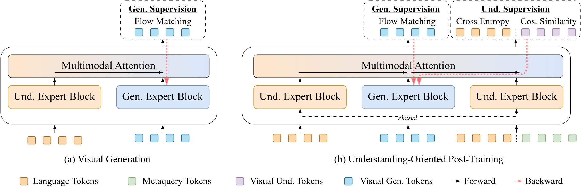

# Steering Visual Generation in Unified Multimodal Models with Understanding Supervision

<a href='https://arxiv.org/abs/2605.05781'>
<a href='https://lzy-tony.github.io/uno'>
<a href='https://huggingface.co/shuidi0020/UNO'>

This is the official implementation of the NeurIPS 2026 paper  [Steering Visual Generation in Unified Multimodal Models with Understanding Supervision](https://arxiv.org/abs/2605.05781).

## :high_brightness: Highlights

Unified multimodal models are envisioned to bridge the gap between understanding and generation. Yet, to achieve competitive performance, state-of-the-art models adopt largely decoupled understanding and generation components. This design, while effective for individual tasks, weakens the connection required for mutual enhancement, leaving the potential synergy empirically uncertain.

We propose to explicitly restore this synergy by introducing **Un**derstanding-**O**riented Post-Training (**UNO**), a lightweight framework that treats understanding not only as a distinct task, but also a supervisory signal to steer generative representations. By incorporating objectives that encode semantic abstraction (captioning) and structural details (visual regression), we enable effective gradient flow from understanding to generation. Extensive experiments on image generation and editing demonstrate that understanding can serve as an effective catalyst for generation.


<div align=center>

</div>

## 🔥 Quick Start

Environments

```bash
conda create -n uno python=3.10 -y
conda activate uno
pip install -r requirements.txt
pip install flash_attn==2.5.8 --no-build-isolation
```

## Training

1. Download example data under `data_example/`

```
data_example
├── uno_t2i
│   ├── chunk_0.parquet
│   ├── chunk_1.parquet
│   ├── ...
|
├── uno_edit
│   ├── chunk_0.parquet
│   ├── chunk_1.parquet
│   ├── ...
```

2. Launch training

For image generation

```
PYTHONPATH=$(pwd) bash scripts/train_uno_gen.sh
```

For image editing:

```
PYTHONPATH=$(pwd) bash scripts/train_uno_edit.sh
```

## Evaluations

### Image Generation

DPG-Bench

```
PYTHONPATH=$(pwd) bash scripts/eval/run_dpg.sh
```

GenEval2

```
PYTHONPATH=$(pwd) bash scripts/eval/run_geneval2.sh
```


UniGenBench++

```
PYTHONPATH=$(pwd) bash scripts/eval/run_unigen.sh
```

For UniGenBench++, see the [official repo](https://github.com/CodeGoat24/UniGenBench) for proceeding Gemini-based evaluations.


### Image Generation

GEdit-Bench

```
PYTHONPATH=$(pwd) scripts/eval/run_gedit.sh
```


## :books: Model Zoo

| Model           | Link                                                         |
| --------------- | ------------------------------------------------------------ |
| UNO_Gen  | [link](https://huggingface.co/shuidi0020/UNO/tree/main/uno_gen) |
| UNO_Edit | [link](https://huggingface.co/shuidi0020/UNO/tree/main/uno_edit) |


## :mailbox_with_mail: Contact

⛽⛽⛽ [liuzeyu24@mails.tsinghua.edu.cn](liuzeyu24@mails.tsinghua.edu.cn)

## :bookmark: Acknowledgements

Our implementation is based on [BAGEL](https://github.com/bytedance-seed/BAGEL) and [RecA](https://github.com/HorizonWind2004/reconstruction-alignment).

We thank the authors for their excellent work.

## :mailbox_with_mail: Citation
If you find this code useful in your research, please consider citing:

```
@article{liu2026steering,
  title={Steering Visual Generation in Unified Multimodal Models with Understanding Supervision},
  author={Liu, Zeyu and Ni, Zanlin and Yue, Yang and Da, Cheng and Yang, Huan and Zhang, Di and Gai, Kun and Huang, Gao},
  journal={arXiv preprint arXiv:2605.05781},
  year={2026}
}
```
